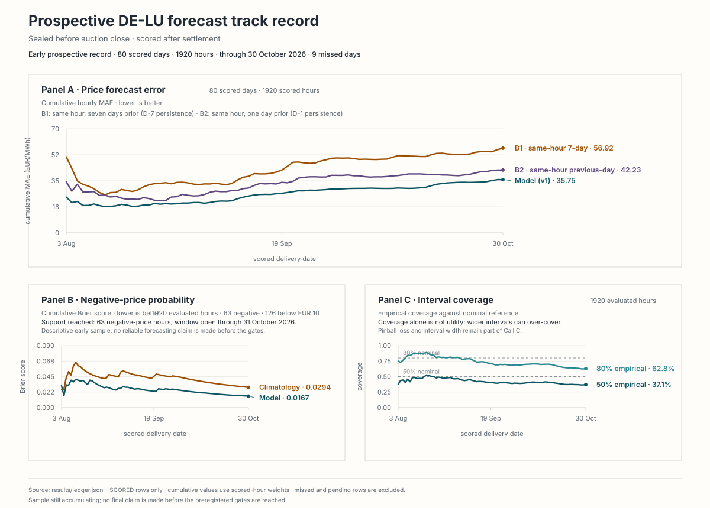

# Live day-ahead forecasting track record — DE-LU power

Daily forecasts of hourly DE-LU day-ahead prices, negative-price probabilities
and prediction intervals, published before auction close and scored after settlement.
The frozen model uses forward weather forecasts with realised market history;
performance is compared with same-hour-last-week and climatological baselines.

The first prospective evaluation ran from 3 August to **31 October 2026** and
is closed. Its formal assessment was written by the scoring job once every
window day had been scored or recorded missed:
[`results/FINAL_REPORT.md`](results/FINAL_REPORT.md). A second phase with a new
model is running now, described below.
**No tradeable edge or P&L is claimed:** these baselines do not measure what the
market had already priced in.

[](results/README.md)

[Scored record](results/README.md) · [Frozen methodology and success criteria](PREREGISTRATION.md) · [v1 lessons and v2 plan](docs/v1-lessons.md)

## Phase 2: model v2

Phase 1 closed on 31 October 2026 and is judged in
[`results/FINAL_REPORT.md`](results/FINAL_REPORT.md): price level PASS,
negative hours PASS, intervals NULL, and nine missed days including the
clock-change day.

A second phase runs from the first v2 forecast to **28 February 2027**, under
its own pre-registration, [`PREREGISTRATION_PHASE2.md`](PREREGISTRATION_PHASE2.md),
frozen before that forecast. Model v2 predicts the change from the same hour
yesterday instead of a price level, and is judged against yesterday's price,
the harder of the two naive baselines. Its forecasts are sealed in
[`predictions/v2/`](predictions/v2) and scored in [`results/v2/`](results/v2).
v1 keeps sealing, unchanged, as a benchmark.

What went wrong in phase 1 and what v2 does about it is in
[`docs/v1-lessons.md`](docs/v1-lessons.md). Known limits of the phase-2 record,
including everything an independent audit found on its first day, are in
[`docs/phase2-disclosures.md`](docs/phase2-disclosures.md). The replay that chose the design,
which is not evidence for it, is in [`research/v2/`](research/v2).

The rest of this page describes phase 1.

## Preregistered evaluation

Three calls are pre-registered:

| Call | Target | Success criterion |
|---|---|---|
| **A** | Hourly day-ahead price level | Positive MAE skill vs same-hour-last-week, 95% block-bootstrap CI excluding zero |
| **B** | Hours clearing below 0 EUR/MWh | PR-AUC beats an hour-of-day/month climatology, CI excluding zero |
| **C** | 50% and 80% prediction intervals | Empirical coverage within 5pp of nominal at both levels |

A null on all three calls is a possible outcome and will be reported as such.

## The look-ahead trap this design exists to avoid

The obvious way to build this is to feed the model SMARD's published day-ahead
forecasts for load, wind and solar. That would be wrong, and not obviously so.

Probed on 2026-08-01 at 10:38 Europe/Berlin — 82 minutes before the auction
closed — every SMARD forecast series was populated only through 23:00 of the
*current* day. Zero of the next day's 24 hours were available:

```
series                   last populated (Berlin)      D+   tomorrow hrs
----------------------------------------------------------------------
price_da                 2026-08-01T23:00:00+02:00    D+0  0/24
load_fc                  2026-08-01T23:00:00+02:00    D+0  0/24
renewables_fc            2026-08-01T23:00:00+02:00    D+0  0/24
residual_load_fc         2026-08-01T23:00:00+02:00    D+0  0/24
```

SMARD publishes D+1 forecasts only *after* the auction has cleared. A model
consuming them would be reading information published after the event it claims
to predict — and because the data arrives eventually, a backtest over history
would look entirely healthy while the live system was quietly cheating.

So SMARD is used for history, lags and scoring only. Forward drivers come from
Open-Meteo numerical weather forecasts, which publish a genuine three-day
horizon. This makes the renewables forecast the model's own work rather than a
thin wrapper over the TSOs'.

---

## Filter identification

SMARD returns no usable labels in its `meta` block, so the filter IDs were
verified arithmetically against a live payload rather than taken on trust:

```
5097 == 123 + 3791 + 125     renewables fc == wind onshore + offshore + solar
715  == 122 - 5097           residual load fc == load fc - renewables fc
```

Both held exactly (max error 0.01 MW, rounding), pinning `122` as load forecast,
`5097` as total renewables forecast and `715` as residual load forecast. A
widely-cited ID for load forecast, `4359`, was **rejected**: its values sit
around 8 GW, an order of magnitude below German system load.

These identities are re-checked at runtime on every prediction run. A breach
aborts the run rather than letting a relabelled series reach the model.

---

## Calibration

Raw XGBoost quantile regression turned out to be badly overconfident: the first
walk-forward check returned 0.67 empirical coverage at a nominal 0.80, and 0.37
at a nominal 0.50 — both far outside the ±5pp band call C is judged against.

Rather than widen the intervals by a hand-picked constant until the number
looked right (which is fitting to the very thing being tested), the fix is
split-conformal calibration. The last 20% of training data is held out, never
used to fit the quantile model, and used only to measure how far outside its own
interval the model actually lands. Expanding by that measured amount gives
marginal coverage of at least the nominal level under exchangeability:

| Interval | Before | After | Nominal |
|---|---|---|---|
| 80% | 0.671 | 0.831 | 0.800 |
| 50% | 0.371 | 0.529 | 0.500 |

Time series are not exchangeable, so this is an approximation rather than the
finite-sample guarantee the theory offers. Both now err slightly wide, which is
the safer direction.

### A reproducibility caveat

Two training runs with identical seeds and inputs produced slightly different
fold MAEs (pooled skill +0.4665 vs +0.4818). The likely cause is non-deterministic
float summation across XGBoost's worker threads. This does not affect any claim
made here: predictions come from the **frozen artefacts**, whose SHA-256 hashes
are recorded in `models/v1/MANIFEST.json` and in every sealed prediction. Exact
re-training reproducibility is a separate and weaker property than prediction
reproducibility, and only the latter is relied on.

## Integrity mechanisms

- `predictions/` is **write-once**; CI fails the build if an existing file there
  is modified or deleted.
- Predictions are generated by scheduled GitHub Actions, so commit timestamps
  are GitHub's, not a local clock.
- Scoring is a separate job that only ever appends to `results/`.
- Every input payload is SHA-256 hashed into the sealed prediction.
- A failed run is recorded as `MISSED` and **cannot be backfilled**. The final
  report states the missed-day count.

---

## Layout

```
PREREGISTRATION.md     frozen before the first prediction
PREREGISTRATION_PHASE2.md  frozen before the first v2 prediction
src/de_power_live/
  v2/                  model v2: features, model, seal, scoring, report
  smard.py             SMARD client, runtime identity checks
  weather.py           Open-Meteo client, turbine power curve, national drivers
predictions/           write-once sealed forecasts
results/               append-only scoring ledger
models/                frozen model artefacts and manifests
.github/workflows/     scheduled predict / score / integrity jobs
```

## Running locally

```bash
python -m venv .venv
.venv/Scripts/Activate.ps1        # PowerShell
python -m pip install -e ".[dev]"
pytest
```

---

Author: Jacob Mackey · [jacobmackey.com](https://jacobmackey.com) · MIT licensed.
